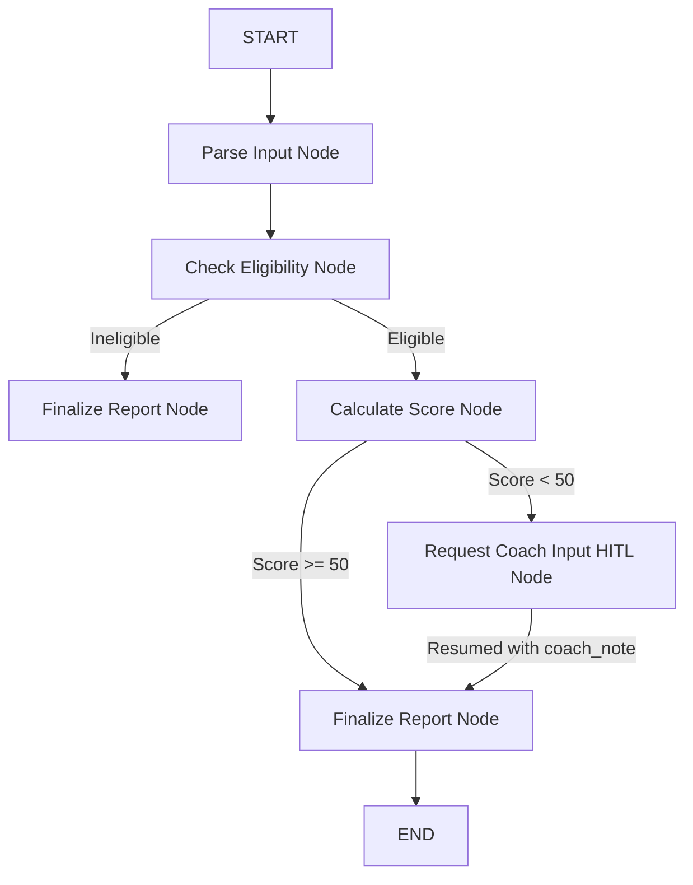

# Perimeter AI — Daily Hormonal Balance Motivator (Agents for Good)

Perimeter AI is a daily hormone-balancing motivatior application designed specifically for perimenopausal women (under the **Agents for Good** track). The application screen eligibility, tracks daily wellness choices, grades performance, and uses a human-in-the-loop coaching portal to review and encourage users who need additional support.

---

## 🚀 Key Features

* **Sleek Glassmorphic Pastel UI**: Styled in soothing pastel hues (mint, rose, lavender, peach) with smooth hover micro-animations.
* **Secure User Authentication**: Sign up and login using a secure, persistent SQLite database.
* **Dynamic Checkbox Log**: Check multiple daily activities for 6 key hormones: Estrogen, Progesterone, Insulin, Cortisol, LH/FSH, and Melatonin.
* **Custom Hormonal Scoring Rules**:
  * First correct activity: **+10 points**.
  * Additional correct activities: **+3 points** each.
  * Incorrect activities: **-5 points** each.
* **Interactive Monthly Wellness Calendar**: Visualize your daily balance score logs directly on a calendar grid.
* **Human-In-The-Loop Coaching Review**: Scores below 50 suspend the loop and route to the **Health Coach Portal** for personalized coach notes.
* **Model Context Protocol (MCP)**: Dynamic stdio-based MCP server (`app/mcp_server.py`) queries correct target wellness guidelines for the agent graph workflow.

---

## 🛠 Tech Stack

* **Language**: Python 3.11+
* **Framework**: FastAPI (Backend) & Vanilla HTML5/CSS3/JavaScript (Frontend)
* **Agent Engine**: Google ADK (Agent Development Kit) Graph Workflow
* **LLM Engine**: Gemini (`gemini-3.1-pro`) via Vertex AI
* **Database**: SQLite (Local file `app/perimeter_db.db`)
* **Package Manager**: UV

---

## 🏗 System Architecture & Workflow

The application operates as a directed acyclic graph (DAG) workflow:



---

## 💻 Local Setup & Execution

### 1. Install Dependencies
Ensure you have `uv` installed. Run:
```bash
uv sync
```

### 2. Configure Environment Variables
Create a `.env` file in the root directory:
```env
GEMINI_API_KEY=your_gemini_api_key
```

### 3. Run FastAPI Application
Start the local development server:
```bash
uv run uvicorn app.fast_api_app:app --host 127.0.0.1 --port 8080
```
Open [http://127.0.0.1:8080](http://127.0.0.1:8080) in your web browser.

### 4. Run Automated Pytests
Run the unit test suite:
```bash
uv run pytest
```

---

## ☁️ Google Cloud Platform (GCP) Deployment

This project is prepared for single-command containerized deployment to **Google Cloud Run** using the provided `Dockerfile`.

1. Authenticate with Google Cloud CLI:
   ```bash
   gcloud auth login
   ```
2. Deploy to Cloud Run:
   ```bash
   gcloud run deploy perimeter-ai --source . --port 8080 --allow-unauthenticated
   ```
