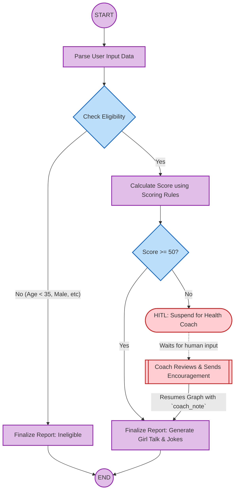

# Peri-Meter AI — Daily Hormonal Balance Motivator (Agents for Good)

Peri-Meter AI is a daily hormone-balancing wellness tracking application designed specifically for perimenopausal women under the **Agents for Good** track.

---

## 📌 The Problem
During perimenopause, women experience significant shifts in key hormones (Estrogen, Progesterone, LH/FSH, Insulin, Cortisol, and Melatonin), leading to symptoms like sleep disruption, hot flashes, fatigue, and mood changes. Managing these symptoms requires consistent daily lifestyle practices (sleep hygiene, stress management, nutrition, exercise). However:
1. Traditional trackers are overly complex, punitive, or generic (not focused on perimenopause).
2. Users lack active, direct connection with a professional health coach when their scores drop.
3. Users struggle to find personalized encouragement and positive reinforcement.

---

## 💡 The Solution
Peri-Meter AI provides a supportive, encouraging, and validated portal for perimenopausal women to track daily lifestyle behaviors:
* **Targeted Tracking:** Focused on key wellness practices that directly balance the 6 target hormones.
* **Positive Reinforcement:** Employs a positive-only scoring system (no penalties) to motivate users.
* **Dynamic AI Coaching:** Uses Gemini to generate highly personalized daily pep talks and humor based on their scoring.
* **Human-in-the-Loop (HITL) Integration:** Automatically routes logs with scores under 50 to a certified Health Coach for personalized review and encouragement before release.
* **Credentials Recovery & Security:** Simple recovery of credentials via email simulation and strict, memorable credential rules for secure logins.

---

## 🚀 Key Features

* **Sleek Glassmorphic Pastel UI**: Styled in soothing pastel hues (mint, rose, lavender, peach) with smooth hover micro-animations.
* **Secure User Onboarding & Validation**:
  * **Username:** Maximum 8 characters.
  * **Password:** Exactly 8 characters (combination of letters, digits, and special characters `!`, `@`, `#` only).
  * Automatically handles conflicts: Overwrites/deletes older ineligible profiles if a user wants to correct details under the same username.
* **Credentials Recovery**: A **"Forgot Username/Password?"** retrieval flow that searches the SQLite database by email and sends simulated credentials log alerts.
* **Positive scoring rules**:
  * First correct activity: **+10 points** per hormone.
  * Additional correct activities: **+3 points** each.
  * No negative point penalties.
* **Interactive Monthly Wellness Calendar**: View history logs and click on any calendar date to display score breakdown, coach feedback, dynamic pep talk, and jokes.
* **Human-In-The-Loop (HITL) Portal**: Scores below 50 suspend the workflow loop and route to the **Health Coach Portal** for manual coach review and approval.
* **Model Context Protocol (MCP)**: A custom stdio-based MCP server (`app/mcp_server.py`) queries correct target wellness guidelines for the agent graph.

---

## 🛠 Tech Stack

* **Language**: Python 3.11+
* **Framework**: FastAPI (Backend) & Vanilla HTML5/CSS3/JavaScript (Frontend)
* **Agent Engine**: Google ADK (Agent Development Kit) Graph Workflow
* **LLM Engine**: Gemini (`gemini-3.1-pro`) via Vertex AI
* **Database**: SQLite (Local file `app/perimeter_db.db`)
* **Package Manager**: UV

---

## 🏗 System Architecture & Workflow

The application operates as a directed acyclic graph (DAG) workflow:



---

## 💻 Local Setup & Execution

### 1. Install Dependencies
Ensure you have `uv` installed. Run:
```bash
uv sync
```

### 2. Configure Environment Variables
Create a `.env` file in the root directory:
```env
GEMINI_API_KEY=your_gemini_api_key
```

### 3. Run FastAPI Application
Start the local development server:
```bash
uv run uvicorn app.fast_api_app:app --host 127.0.0.1 --port 8080
```
Open [http://127.0.0.1:8080](http://127.0.0.1:8080) in your web browser.

### 4. Run Automated Pytests
Run the unit test suite:
```bash
uv run pytest
```

---

## ☁️ Google Cloud Platform (GCP) Deployment

This project is prepared for single-command containerized deployment to **Google Cloud Run** using the provided `Dockerfile`.

1. Authenticate with Google Cloud CLI:
   ```bash
   gcloud auth login
   ```
2. Deploy to Cloud Run:
   ```bash
   gcloud run deploy perimeter-ai --source . --port 8080 --allow-unauthenticated
   ```
